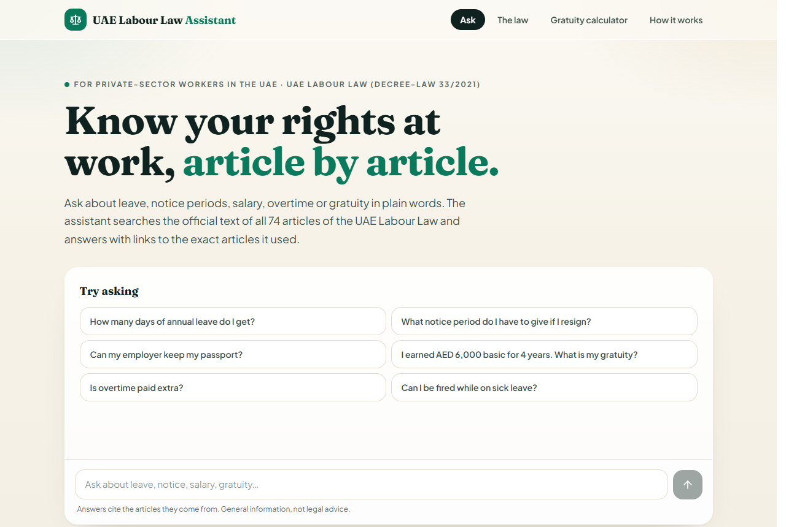
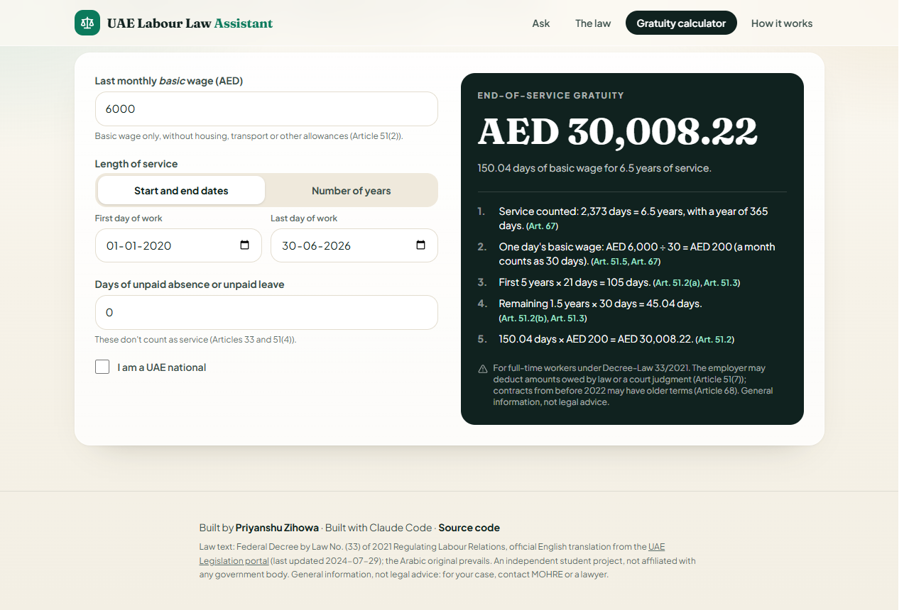
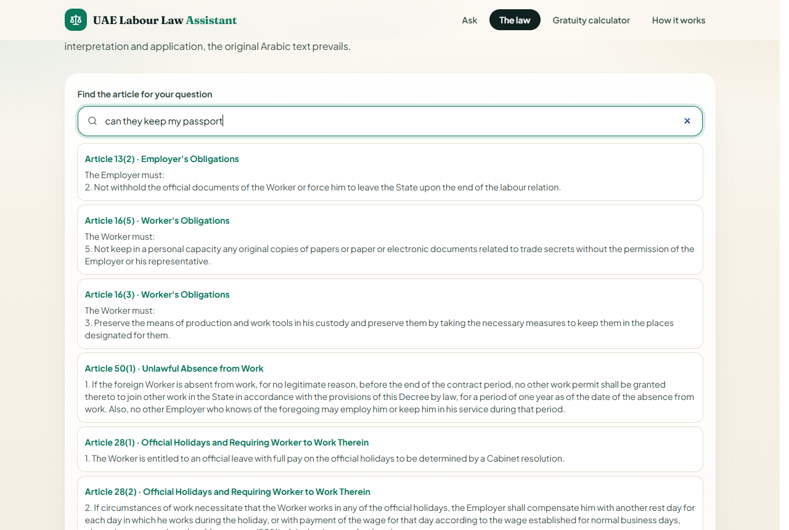

# UAE Labour Law Assistant ⚖️

Ask questions about your rights at work in the UAE, in plain words, and get answers that **cite the exact articles** of the UAE Labour Law (Federal Decree-Law No. 33 of 2021). Includes an end-of-service **gratuity calculator** and the full law, searchable.

**🔗 Live:** https://uae-labour-law-assistant.vercel.app
**👤 Portfolio:** https://priyanshu-zihowa.vercel.app



---

## What it does

| | |
|---|---|
| **Ask** | “What notice period do I have to give if I resign?” → an answer with links like [Article 43(1)](https://uae-labour-law-assistant.vercel.app/articles/43#clause-1). Under every answer, the clauses the AI read. |
| **The law** | All 74 articles, grouped by topic, each clause linkable, with a search that understands everyday words |
| **Gratuity calculator** | Article 51 step by step: 21 days per year for the first five years, 30 after, part years in proportion, unpaid absence removed, capped at two years’ wage |
| **Works without AI** | Search, articles and calculator need no AI service. If the AI is down or out of free quota, the chat shows the most relevant clauses instead |



## How it works: RAG with retrieval as a tool

```
question ──► Gemini (function calling)
               │  search_law("warning period resignation")   ← may search several times,
               │  get_article(43)                               in the law's own words
               │  calculate_gratuity(6000, 4 years)          ← exact arithmetic, never the model's
               ▼
           answer that cites [Article 43(1)](/articles/43#clause-1) …
```

1. **Source text.** The official English translation from the [UAE Legislation portal](https://uaelegislation.gov.ae/en/legislations/1541) (last updated 29 Jul 2024), saved in `data/source/` and checked chunk by chunk against the original with SHA-256.
2. **Parsing** (`pipeline/build_articles.py`, unit-tested): 74 articles → 276 passages (numbered clauses keep their sub-items; definitions split per term; a clause’s lead sentence such as “The Worker must:” is repeated on each clause).
3. **Retrieval** (`src/lib/search.ts`): BM25 over the passages, article titles counted twice, and a small dictionary that adds the law’s words to everyday questions: *notice* → *warning period*, *passport* → *official documents*, *salary* → *wage*, *fired* → *dismissal*. Runs on the server (as the AI’s tool) and in the browser (article finder, fallback).
4. **Generation** (`src/lib/assistant/`): a Gemini agent on the REST API with three tools. The prompt requires answering only from retrieved clauses, citing each, and calling the calculator for any gratuity amount. Model discovery and fallback when a model is busy or out of free quota; per-visitor rate limit; the API key lives only in Vercel’s environment.



## Evaluation

**Retrieval** (`npm run eval:retrieval`, no AI needed): questions in everyday language, each labelled with the article that answers it. The **test** set (30 questions) was written and committed *before* any tuning ([`eval/retrieval-test.sha256`](eval/retrieval-test.sha256), git history) and never used to improve the search. The **dev** set (45 questions) was used to find gaps in the dictionary.

| Test set, 30 unseen questions | Found 1st | In top 3 | In top 5 |
|---|---|---|---|
| BM25 on clause text | 47% | 60% | 70% |
| + article titles | 53% | 67% | 67% |
| **+ everyday-words dictionary (the app)** | **67%** | **90%** | **93%** |

Dev set with the app’s search: 98% in the top 5. Misses are listed in [eval/retrieval-results.md](eval/retrieval-results.md).

**Gratuity and search unit tests** (`npm test`, 14 tests): 3, 7 and 30 years (cap), part years, under one year, unpaid absence, leap years, UAE nationals; search finds the right article for common questions and respects “Article N”.

**What I learned:** the hard part of legal RAG is vocabulary, not the model. The law never says “notice period” or “passport”, so plain keyword search missed them; a 40-entry dictionary lifted top-3 retrieval on unseen questions from 67% to 90%. Keeping a held-out test set, written before tuning, is what makes that number honest.

## Limitations

- Covers the Decree-Law only, not the Executive Regulation (Cabinet Resolution No. 1 of 2022) or ministerial decisions, which add many details.
- Not for domestic workers, government employees or the armed forces (Article 3). DIFC and ADGM free zones have their own employment laws.
- The English text is a translation; the Arabic original prevails.
- General information, not legal advice. For a real case, contact MOHRE or a lawyer.

## Run it yourself

```bash
npm install
```

```bash
npm test
```

```bash
npm run eval:retrieval
```

```bash
npm run dev
```

For the AI chat, create a free key in [Google AI Studio](https://aistudio.google.com/apikey) and put it in `.env.local` as `GEMINI_API_KEY=...` (never commit it). Without a key, everything except the AI answers works. To rebuild `src/data/law.json` from the source text: `python pipeline/build_articles.py` (tests: `python -m unittest discover -s pipeline`).

## Tech

TypeScript · Next.js 15 · React 19 · Tailwind CSS 4 · Gemini API (function calling) · BM25 · Python (parsing) · Vercel

## Credits

- Law text: Federal Decree by Law No. (33) of 2021 Regulating Labour Relations, official English translation, [UAE Legislation portal](https://uaelegislation.gov.ae/en/legislations/1541).
- Built by **Priyanshu Zihowa**, with Claude Code as a coding assistant.
- Code: MIT License. An independent student project, not affiliated with any UAE government body.
